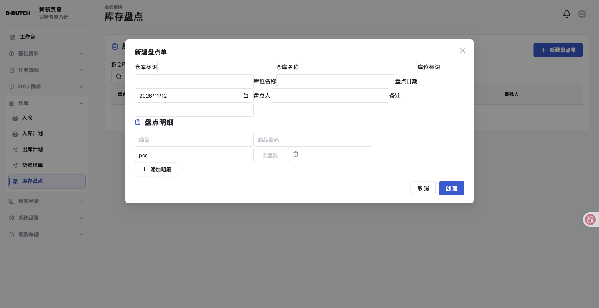

# 组件尺寸与对齐盘点（2026-11-12）

## 结论

当前存在跨页面的尺寸与布局规则冲突，不能只缩短“新增供应商”按钮解决。本轮归纳 **8 类问题：2 项高优先级、5 项中优先级、1 项低优先级**。高优先级指明显干扰字段识别或首屏业务操作，不代表业务接口故障。

直接影响最大的三个现象：

1. 库存盘点新建弹窗缺少布局样式，标签与输入框按行内内容连续换行。
2. 样品登记、打样、寄样的筛选控件每项占满一行，桌面端列表被推到首屏底部。
3. 同一列里选择框受 300px 上限约束，新增辅助按钮却拉满 340px；其他列表的操作按钮也会被当成筛选列拉宽。

本轮只盘点，未修改业务源码、未提交业务数据。已新增本报告和截图、尺寸证据。

> 2026-11-12 已按共享样式契约完成修复，逐项状态见「问题清单」与文末「修复记录与验收」。

## 范围、方法与判定标准

- 直接使用 ego-lite 浏览 `http://localhost:8080`，打开列表、辅助入口、创建弹窗，检查滚动后的布局；没有以源码推测代替已验证的问题。
- 桌面内容视口 **1512 × 780 CSS px**。原始尺寸来自 DOM `getBoundingClientRect()`，按整数四舍五入；1px 级误差不作为缺陷。
- 共检查 **20 个路由、14 种表单/弹窗、10 个列表状态**，保存 24 组尺寸快照。路由覆盖见文末。
- 按 [仓库级 UI 设计规范](13-仓库级UI设计规范.md) §3、§4.3、§5.1、§5.2 判定：同级控件共用基线、常规高度 36px、操作组与字段分离、按钮按内容定宽。
- **不要求所有控件同宽**：金额/税率可以使用较紧凑宽度；查询、创建、危险操作可以随文字伸缩。问题在于没有明确布局意图的拉伸、断行、错位及同级尺寸冲突。
- 截图为本轮现场；完整数据见 [measurements.json](checks/ui-alignment-2026-11-12/measurements.json)。数据包含超出滚动容器首屏的控件坐标，负坐标或超出视口不单独视为缺陷。
- 尚未覆盖移动端、其他视口、所有权限分支、有数据后的明细编辑与全部业务详情。本报告不宣称已穷尽整个仓库。

## 问题清单

| 编号 | 优先级 | 问题 | 已验证范围 | 主要修复位置 | 状态 |
| --- | --- | --- | --- | --- | --- |
| ALIGN-01 | 高 | 库存盘点表单与明细布局类没有样式定义 | 新建盘点单 | `StocktakesPage.tsx`、`warehouse-pages.css` | 已完成 |
| ALIGN-02 | 中 | 辅助新增按钮比同列选择框更宽，增加单行高度 | 采购合同“新增供应商”、出口合同“新增客户” | `shared-primitives.css`、`ux-pass.css` | 已完成 |
| ALIGN-03 | 中 | 表单列宽随容器变化，控件却被全局 300px 截断 | 入库、入库计划、出库计划、货物出库、合同 | `antd-and-login.css`、`design-system-apply.css` | 已完成 |
| ALIGN-04 | 高 | 桌面筛选控件被拉成每项独占整行 | 样品登记、打样、寄样 | `sample-pages.css` | 已完成 |
| ALIGN-05 | 中 | 查询和新增按钮作为 Grid 子项被拉宽、落入下一行 | 收款、报销、出口报价、出货明细 | `design-system-apply.css`、`workspace-shell.css` | 已完成 |
| ALIGN-06 | 中 | 带后缀数字控件与同行普通控件基线、高度不一致 | 商品税率、退税率 | `ProductFormModal.tsx`、`design-system-apply.css` | 已完成 |
| ALIGN-07 | 中 | 多行输入框被普通输入高度规则压成 34px | 商品、供应商、客户、QC、出库、水单 | `antd-and-login.css`、`design-system-apply.css` | 已完成 |
| ALIGN-08 | 低 | 常规操作高度 34/36/38px 混用，操作区位置也不一致 | 合同辅助按钮、仓库工作流、QC、样品、报销 | `shared-primitives.css`、`shared-page-primitives.css`、`workspace-shell.css`、`masterdata-pages.css` | 已完成 |

### ALIGN-01：库存盘点缺少表单栅格和明细行样式

复现：仓库 → 库存盘点 → 新建盘点单。

标签和输入框像普通行内文本一样挤在一起。仓库标识、仓库名称、库位标识、库位名称不能形成清楚的上下对应；日期与盘点人也接在前一项后面。商品明细的商品/编码一行、单位/实盘数另一行，删除按钮又与输入框偏移。

实测：仓库标识输入框位于 `x=397, y=152, 300×36`；相邻库位标识已换到 `x=340, y=188`。标签元素的高仅 17px，而对应输入高 36px，无法建立一致的字段盒。明细删除按钮在 `y=372`，同行输入在 `y=375`。

源码证据：[StocktakesPage.tsx](../frontend/src/app/pages/warehouse/StocktakesPage.tsx) 使用 `.form-grid`、`.stocktake-lines`、`.stocktake-line`；搜索 `frontend/src` 的 CSS 未找到这三类的布局定义，运行页 CSSOM 也未找到 `.form-grid` 定义。

建议：接入有明确列宽和 gap 的表单容器；标签采用块级字段布局；明细使用单独的商品/编码/单位/数量/操作栅格。先修结构，再调整控件宽度，不用逐个 margin 补位置。

### ALIGN-02：辅助新增按钮被 flex 字段拉满

复现：采购合同 → 新增采购合同；出口合同 → 新增合同。当前无供应商/客户时显示辅助按钮。

| 场景 | 选择框 | 辅助按钮 | 差异 |
| --- | --- | --- | --- |
| 采购供应商 | `300×36`，x=940 | `340×34`，x=940 | 右边多出 40px、高度少 2px |
| 出口客户 | `300×36`，x=228 | `340×34`，x=228 | 同上 |

选择框下方增加按钮后，字段盒高 102px，第一行后的留白显著增加。采购下一行输入的 y=316，而首行输入 y=205，相差 111px；后续正常行只相差约 69px。

源码证据：`shared-primitives.css` 的 `.contract-modal-form .form-row > label` 是纵向 flex，按钮未设置 `align-self`/内容宽度，默认横向 stretch。紧接的按钮规则虽然注释写“自适应宽度”，实际只声明高度、圆角、字重。`ux-pass.css` 的 `.inline-create-link` 也没有约束横向伸缩。

建议：辅助新增使用内容宽文字操作，明确 `align-self: flex-start` 和内容宽度；或者放在标签行右侧/选择器空状态中。统一字段辅助区的间距，不让辅助操作改变同列边界。

截图：[采购合同](checks/ui-alignment-2026-11-12/purchase.png)、[出口合同](checks/ui-alignment-2026-11-12/export.png)。

### ALIGN-03：容器列宽与输入框宽度不是同一套规则

入库登记的字段盒宽 430px，但输入框/选择框固定为 300px，列内留下 130px 空白；单列字段盒宽 876px，输入框依然只有 300px。入库计划与出库计划也有相同形态。

这不是要求单号必须填满整行，而是目前布局既没有“固定字段宽度”的列定义，也没有“填满字段列”的控件约束：外层继续放大，内层在 300px 截止，产生不稳定的水平节奏，且与 ALIGN-02 的撑满按钮直接冲突。

源码证据：`antd-and-login.css:91` 将 `.ant-input`、`.ant-input-affix-wrapper`、`.ant-input-number`、`.ant-picker` 全局限制为 `max-width:300px`；`:103` 同样限制 `.ant-select`。部分列表在 `design-system-apply.css:264` 又解除这一限制，导致列表和弹窗使用不同宽度契约。

建议：宽度由字段容器决定；常规控件填满列，紧凑数值/编号通过显式字段变体限宽。不要直接全局删掉 300px 后让所有旧页面任意变宽，应先确定表单列规格再迁移。

截图：[入库登记](checks/ui-alignment-2026-11-12/inbound-form.png)、[入库计划](checks/ui-alignment-2026-11-12/inbound-plan.png)、[出库计划](checks/ui-alignment-2026-11-12/outbound-plan.png)、[出库登记](checks/ui-alignment-2026-11-12/outbound-form.png)。

### ALIGN-04：样品模块桌面筛选每项占满一行

1512px 桌面视口下，三个页面的每个筛选控件均宽 **1186px**：

| 页面 | 字段数 | 首个输入 y | 最后输入 y | 操作按钮 y |
| --- | --- | --- | --- | --- |
| 样品登记 | 4 | 257 | 467 | 515 |
| 打样管理 | 5 | 257 | 537 | 585 |
| 寄样管理 | 6 | 257 | 607 | 655 |

寄样表头已经被推到 y≈722，首屏几乎只剩筛选表单。状态和日期字段并不需要 1186px 的宽度。

源码证据：`sample-pages.css:80` 使用 flex wrap；`design-system-apply.css:254` 给筛选 label 设置 `width:100%; flex:none`，在 flex 容器中让每项单独占满一行。列表的 compact 字段无法获得预期的 160px 宽度。

建议：迁移到共享工具栏；关键词优先，状态/日期按明确列宽排列，低频条件折叠。不要给这三个页面继续补单项 `width:... !important`。

截图：[样品登记](checks/ui-alignment-2026-11-12/sample-record-list.png)、[打样](checks/ui-alignment-2026-11-12/sample-request-list.png)、[寄样](checks/ui-alignment-2026-11-12/sample-delivery-list.png)。

### ALIGN-05：Grid 把操作按钮当成字段列拉宽

| 页面 | 实测操作宽度 | 正常对照 |
| --- | --- | --- |
| 收款管理 | 查询 190px、水单录入 190px | 付款管理查询 85px、发票登记 111px |
| 报销管理 | 查询 190px、新增报销 190px | 同上 |
| 出口报价 | 查询 190px、新增出口报价 190px | 出口合同采用内容宽工具栏 |
| 出货明细 | 查询 190px；生成按钮换到下一行且宽 381px | 同一类单据新增操作不应随搜索列宽改变 |

根因是这些页面直接把 Button 放进通用五列 `.inline-filters` Grid，没有独立 ActionGroup；页面字段数量一变，按钮就继承不同列宽或换行位置。已有的 `single-line-filter-toolbar`/`filter-actions` 只覆盖部分页面，迁移不完整。

建议：操作独立分组、内容定宽、统一右对齐；字段可以弹性伸缩，操作不参与字段列的均分。无需强制不同文案按钮都做成 85px。

截图：[收款](checks/ui-alignment-2026-11-12/finance-receipts.png)、[报销](checks/ui-alignment-2026-11-12/finance-reimbursements.png)、[出口报价](checks/ui-alignment-2026-11-12/quotation-list.png)、[出货明细](checks/ui-alignment-2026-11-12/shipment-list.png)。

### ALIGN-06：百分比复合控件的高度和基线漏管

商品新增中，海关编码/状态的输入面在 `y=305`、高 36px；同行税率数字面在 `y=297`、高 34px，**上下错开 8px**。退税率也使用高 34px 的数字面。普通字段约 299px 宽，数字本体 90px（不含 `%` 后缀）；紧凑宽度可以保留，但必须有明确的对齐规则。

根因：`ProductFormModal.tsx` 使用带 `%` 的 `InputNumber addonAfter`，复合包装层没有完整接入 36px 控件契约；辅助说明与字段布局同时影响行内排布。

建议：按“复合控件整体”统一高度、边界和纵向对齐，不能只修内部 input。为说明文字保留独立位置，同行输入面的 top/bottom 一致。

截图：[商品新增](checks/ui-alignment-2026-11-12/product.png)。

### ALIGN-07：TextArea 被单行 Input 高度规则压扁

| 已验证字段 | 尺寸 |
| --- | --- |
| 商品包装资料 | 936×34px |
| 供应商、客户风险备注 | 936×34px |
| QC 任务说明 | 756×34px |
| 出库异常原因 | 876×34px |
| 水单备注 | 672×34px |

这些字段宽度可以铺满所在区块，但高度只有 34px，表现接近单行输入，长说明录入和回读都不方便。

源码证据：Ant TextArea 也有 `.ant-input` 类，全局 `.ant-input { height:34px !important }` 将多行控件纳入单行高度限制。局部 min-height/rows 没有形成稳定的最终尺寸。

建议：单行输入规则明确排除 textarea；多行输入提供独立最小行数和可控自增高范围。宽度仍按字段列，不能用“统一 36px”覆盖多行组件。

截图：[商品](checks/ui-alignment-2026-11-12/product.png)、[供应商](checks/ui-alignment-2026-11-12/supplier.png)、[客户](checks/ui-alignment-2026-11-12/customer.png)、[QC](checks/ui-alignment-2026-11-12/qc-form.png)、[水单](checks/ui-alignment-2026-11-12/receipt-form.png)。

### ALIGN-08：高度和操作区规范仍有迁移尾项

常规输入、列表按钮、标准弹窗按钮大多已经是 36px；合同辅助按钮是 34px；仓库工作流、QC 创建及样品列表按钮仍有 38px。仓库/QC/报销的提交动作留在内容区左侧，采购合同已使用独立 Modal footer，跨模块找操作的位置仍不一致。

源码证据：`shared-page-primitives.css:199` 给工作流按钮 `min-height:38px`；`sample-pages.css:117` 也设置 38px，与 token `--ui-control-height:36px` 不同。共享 `FormModal` 仍把操作放进表单内 `.modal-actions`，采购合同已另行移到 Modal footer。

建议：按普通/紧凑/触摸三种尺寸落到已有 token；工作流分步骤操作可保留在步骤内，但应使用同一操作组布局，不要求所有按钮都搬到同一底栏。复选框、上传缩略图、图标关闭按钮不纳入“全部等高”要求。

## 根因和修复顺序

| 层次 | 当前问题 | 建议 |
| --- | --- | --- |
| 缺失布局 | `.form-grid` / `.stocktake-line` 等有 JSX 无 CSS | 先补库存盘点可读、可换行的字段和明细布局 |
| 尺寸事实源 | token 是 36px，旧分片仍声明 34px / 38px、300px 上限 | 将普通控件尺寸集中到契约层，移除冲突前先验证消费者 |
| 布局模型 | flex 字段遇到 Grid 专用 `width:100%; flex:none` | 字段容器与操作组使用明确的共享布局接口 |
| 复合控件 | 只覆盖旧 `.ant-select-selector` / 内部 input，没有覆盖完整包装层 | 针对当前 Ant Design 6 的实际交互面统一尺寸 |
| 特殊控件 | TextArea 与单行 Input 共用固定 height | 分离单行、多行、复合、上传/复选框等规格 |

实施顺序：先修 ALIGN-01 与 ALIGN-04；再治理全局宽度规则和字段/操作组（ALIGN-02/03/05）；随后校正复合控件与 TextArea（ALIGN-06/07）；最后统一常规高度和操作区（ALIGN-08）。不建议在每个页面分别追加 margin、固定宽度或 `!important`。

## 后续修复验收要求

- “新增供应商/客户”保持内容宽，不能比同列选择框右边界更长；辅助操作不再意外扩大行高。
- 同行普通输入、Select、InputNumber 整体高度 36px，top/bottom 误差不超过 1px；紧凑控件使用独立尺寸规格。
- 大屏表单中的列宽与控件宽度一致，编号/金额等紧凑字段要有显式变体，不依赖全局 300px 截断。
- 三个样品页面的默认筛选区按桌面工具栏组织，表格不再被多行全宽筛选推到底部。
- 查询与新增操作不参与字段 Grid 的均分；多出来的按钮不会独占 381px 搜索列。
- 库存盘点标签与控件形成独立字段盒，明细行新增/删除后仍维持列对齐。
- TextArea 至少能清楚呈现多行内容，长文本不会被固定 34px 高度裁成单行。
- 修复后按仓库规范复查 1440px、390px，并补充常用笔记本宽度；本轮 1512px 截图只作为问题证据，不是新视觉基准。
- CSS 变更需重跑对应受影响页面，不能用 typecheck/单元测试通过代替尺寸实测；不为每个像素值编写镜像断言。

## 覆盖清单与边界

| 范围 | 路由 | 本轮检查 |
| --- | --- | --- |
| 合同 | `/purchase/contracts`、`/sales/contracts` | 两种新增弹窗、辅助新增按钮、明细区域 |
| 主数据 | `/masterdata/products`、`/masterdata/suppliers`、`/masterdata/customers` | 三种新增弹窗、税率、说明、TextArea |
| QC | `/quality/inspections` | 新建任务弹窗 |
| 仓库 | `/warehouse/inbound-orders`、`/warehouse/inbound-plans`、`/warehouse/outbound-plans`、`/warehouse/outbound-orders`、`/warehouse/stocktakes` | 五种创建/工作流弹窗；入库列表工具栏 |
| 样品 | `/sample/records`、`/sample/requests`、`/sample/deliveries` | 三种列表筛选与操作布局 |
| 财务 | `/finance/receipts`、`/finance/payments`、`/finance/fees`、`/finance/reimbursements` | 四种列表；水单录入、报销创建弹窗 |
| 销售 | `/sales/quotations`、`/sales/shipments` | 两种列表；生成出货明细弹窗 |

未检查的其他路由、不同权限、校验错误展开状态、有数据后的行编辑及全部小屏状态不能据此判定通过。源码中可推导出的影响范围已放在根因说明，未把未浏览的界面当成确认缺陷。

## 已有正确做法

- 入库、付款、付费等列表的常用工具栏已经使用内容宽按钮，主输入与按钮同高 36px，可作为迁移参考。
- 采购弹窗新 footer 已解决覆盖商品表头的问题；本次问题是辅助按钮与字段列尺寸，不能把已修复的遮挡再次记为未完成。
- `design-system.css` 与现有 UI 规范已有尺寸/间距 token，不需要另建一套设计系统。

## 修复记录与验收（2026-11-12）

全部改动集中在样式契约层，未新增页面级 margin 或固定宽度，未修改业务逻辑。规格见 [spec](specs/ui-alignment-2026-11-12/spec.md)。

### 改动位置

| 文件 | 内容 |
| --- | --- |
| `frontend/src/styles/antd-and-login.css` | 常规控件高度 34px → `var(--ui-control-height)`；`textarea.ant-input` 不参与单行高度约束 |
| `frontend/src/styles/design-system-apply.css` | 新增「表单尺寸契约」：字段容器内控件填满列、TextArea 独立 ≥88px、复合数字控件 36px、label 行轨不拉伸、筛选内按钮内容定宽靠右 |
| `frontend/src/styles/warehouse-pages.css` | 新增 `.form-grid`、`.stocktake-lines`、`.stocktake-line` 栅格与 760px 以下单列 |
| `frontend/src/styles/sample-pages.css` | 样品筛选由逐项整行 flex 改为 Grid 工具栏；按钮 38px → token |
| `frontend/src/styles/shared-primitives.css` | 合同字段控件 34px → token；辅助按钮内容定宽、紧凑高度 |
| `frontend/src/styles/shared-page-primitives.css` | 工作流提交按钮 38px → token；筛选/表单 Select、select 高度统一 |
| `frontend/src/styles/workspace-shell.css` | 仓库工作流筛选按钮 38px → token |
| `frontend/src/styles/masterdata-pages.css` | 基础资料筛选按钮与输入 38px → token |
| `frontend/src/styles/ux-pass.css` | `.inline-create-link` 内容定宽、贴左、不撑高 |

### 浏览器实测（1440 × 900，除注明外）

| 检查 | 结果 |
| --- | --- |
| 库存盘点新建弹窗（960 宽实测） | 表单 3 列，每列 267px；7 个字段标签 y 一致、输入 y 一致、高 36px；明细行五列 x=64/353/563/691/860，高 36px 对齐 |
| 库存盘点 390 宽 | 表单与明细均单列 326px，无横向溢出，弹窗 374px |
| 样品登记筛选 | Grid 5 列（279 / 155 × 4），4 个筛选同处 y=235；查询 85px；表格表头 y=370（视口 900），进入首屏 |
| 收款管理操作按钮 | 查询 85px、水单录入 111px，同一行 y=177，靠右相邻；筛选输入 357 / 178px |
| 商品税率 / 退税率 | 与同行海关编码输入 top 均为 311，高均 36px；数字面 90px 保留紧凑宽度 |
| 商品包装资料 TextArea | 936 × 99px，可纵向拖拽 |
| 采购合同辅助新增 | 按钮 94 × 32px，同列选择框 340px，按钮左对齐且不超出选择框右边界 |

### 验证状态

- `npx tsc --noEmit`、`npm run lint` 通过；`npm run test` 384 项通过（存在 1 条与本次无关的既有 `window is not defined` 未处理错误）。
- 前端容器已重建，`localhost:8080` 返回 200，以上数据来自重建后的实测。
- 未覆盖：除商品外的其他 TextArea 只按共享规则验证；有数据后的明细行增删、其他权限分支与全部小屏页面仍为待办。

